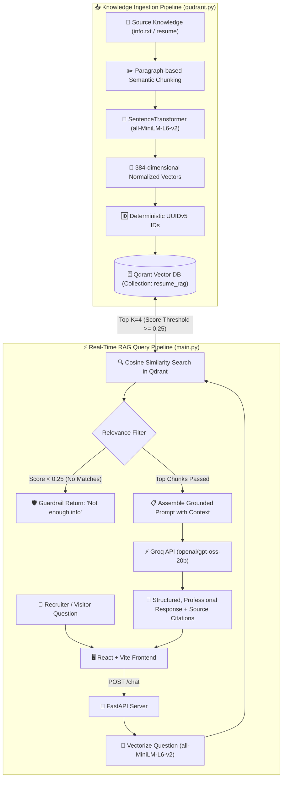

# 🤖 Samir Jadhav — AI Portfolio RAG Chatbot (with Qdrant Vector DB)

[](https://fastapi.tiangolo.com/)
[](https://qdrant.tech/)
[](https://groq.com/)
[](https://huggingface.co/sentence-transformers/all-MiniLM-L6-v2)
[](https://react.dev/)
[](https://vitejs.dev/)

A production-grade, full-stack **Retrieval-Augmented Generation (RAG)** conversational assistant built to represent **Samir Jadhav**'s professional profile, technical stack, internships, and engineering projects. 

Instead of relying on basic prompt stuffing or slow PDF re-parsing on every request, this system leverages **Qdrant Vector Database** and **dense vector semantic search** (`all-MiniLM-L6-v2`) to retrieve exact factual context with cosine similarity and score thresholding before generating grounded, hallucination-free responses via **Groq LLM**.

---

## 🏛️ System Architecture



---

## ✨ Key Features

- **Semantic Vector Search**: Chunks are embedded into 384-dimensional dense vectors using `all-MiniLM-L6-v2` and stored in **Qdrant Vector Database**.
- **Anti-Hallucination Guardrails & Token Saver**: If retrieved chunk similarity is below `SCORE_THRESHOLD = 0.25`, the server gracefully responds without invoking the LLM, eliminating hallucinations and saving API token consumption.
- **Ultra-Fast LLM Inference**: Powered by **Groq** (`openai/gpt-oss-20b`) for lightning-fast latency (~300–800ms generation).
- **FastAPI Lifespan Caching**: Embedding models, Qdrant client, and Groq connections are initialized once during server startup using `asynccontextmanager` lifespan handlers.
- **Interactive Single-Page Frontend**:
  - Full-screen welcome typing animation on load.
  - Interactive chat interface with user/assistant bubbles and typing indicators.
  - Contextual empty state placeholder ("Ask anything about Samir").
  - Fully responsive on mobile, tablet, and desktop screens.
  - Error fallback for sleeping free-tier servers.
- **Source Attribution**: API returns both the generated answer and retrieved chunk references along with their similarity confidence scores.

---

## 📁 Repository Structure

```
RAG/
├── backend/
│   ├── main.py               # Production FastAPI server with Qdrant Vector RAG
│   ├── qudrant.py            # Vector ingestion script (chunks, embeds & upserts to Qdrant)
│   ├── main_without_vdb.py   # Fallback/Legacy architecture (direct PDF-parsing)
│   ├── my_resume.pdf         # Resume PDF document
│   ├── requirements.txt      # Backend Python dependencies
│   └── .env.example          # Environment variables template
├── frontend/
│   ├── src/
│   │   ├── components/
│   │   │   ├── ChatBox.jsx            # Main chat container & API caller
│   │   │   ├── InputBar.jsx           # Query input and send actions
│   │   │   ├── MessageBubble.jsx      # Styled message bubbles
│   │   │   ├── PlaceholderMessage.jsx # Initial empty state banner
│   │   │   ├── TypingIndicator.jsx    # Animated response indicator
│   │   │   └── WelcomeAnimation.jsx   # Hero typing animation
│   │   ├── styles/                    # Modular CSS stylesheets
│   │   ├── App.jsx                    # Root React component
│   │   └── main.jsx                   # React DOM entry point
│   ├── package.json
│   ├── vite.config.js
│   ├── vercel.json           # Vercel SPA routing configuration
│   └── .env.example          # Frontend environment template
├── requirements.txt          # Root Python dependencies
├── DEPLOYMENT.md             # Complete step-by-step deployment guide
└── README.md                 # Project documentation
```

---

## 🛠️ Tech Stack

| Component | Technology | Description |
|---|---|---|
| **Backend API** | [FastAPI](https://fastapi.tiangolo.com/) + Uvicorn | Async web framework for high-throughput REST APIs |
| **Vector Database** | [Qdrant](https://qdrant.tech/) | Cloud or self-hosted vector database with cosine indexing |
| **Embeddings** | [Sentence-Transformers](https://sbert.net/) | `all-MiniLM-L6-v2` (384-dimensional dense vectors) |
| **LLM Inference** | [Groq](https://groq.com/) | High-speed LLM inference engine (`openai/gpt-oss-20b`) |
| **Data Validation** | [Pydantic v2](https://docs.pydantic.dev/) | Request validation and schema enforcement |
| **Frontend UI** | [React 19](https://react.dev/) + [Vite](https://vitejs.dev/) | Modern, blazing-fast single page application |
| **Deployment** | [Render](https://render.com/) & [Vercel](https://vercel.com/) | Cloud hosting for backend and frontend |

---

## 🚀 Getting Started Locally

### 1. Prerequisites
- **Python**: 3.10, 3.11, or 3.12+
- **Node.js**: v18+ & npm
- **Qdrant**: Either a local instance (`docker run -p 6333:6333 qdrant/qdrant`) or a free [Qdrant Cloud Cluster](https://cloud.qdrant.io/)
- **Groq API Key**: Obtainable from the [Groq Console](https://console.groq.com/keys)

---

### 2. Backend Setup

1. **Navigate to the backend directory and activate your virtual environment:**
   ```bash
   cd RAG/backend

   # Windows
   python -m venv venv
   venv\Scripts\activate

   # Linux/macOS
   python3 -m venv venv
   source venv/bin/activate
   ```

2. **Install dependencies:**
   ```bash
   pip install -r requirements.txt
   ```

3. **Configure Environment Variables:**
   Create a `.env` file inside `backend/` based on `.env.example`:
   ```env
   # Groq API Key
   API=gsk_your_groq_api_key_here

   # Qdrant Vector DB
   QDRANT_URL=http://localhost:6333
   QDRANT_API_KEY=your_qdrant_cloud_api_key_if_applicable

   # Frontend Origin for CORS
   FRONTEND_URL=http://localhost:5173
   ```

4. **Ingest Knowledge Vectors into Qdrant:**
   Ensure your knowledge base file (`info.txt`) is present and run:
   ```bash
   python qudrant.py
   ```
   *This creates the `resume_rag` collection in Qdrant, embeds all paragraphs, and upserts them.*

5. **Start the FastAPI Server:**
   ```bash
   uvicorn main:app --reload --port 8000
   ```
   API will be running at `http://localhost:8000`. You can inspect interactive documentation at `http://localhost:8000/docs`.

---

### 3. Frontend Setup

1. **Navigate to the frontend directory:**
   ```bash
   cd ../frontend
   ```

2. **Install Node dependencies:**
   ```bash
   npm install
   ```

3. **Configure Environment Variables:**
   Create a `.env` file inside `frontend/`:
   ```env
   VITE_API_URL=http://localhost:8000
   ```

4. **Run Vite Development Server:**
   ```bash
   npm run dev
   ```
   Open `http://localhost:5173` in your browser to interact with the chatbot!

---

## 📡 API Endpoints

### `GET /`
Returns service status and welcome payload.
```json
{
  "message": "Welcome to Samir Jadhav's Personal & Professional RAG Chatbot API",
  "status": "online",
  "docs": "/docs"
}
```

### `GET /health`
Returns connection status and total indexed vector count from Qdrant.
```json
{
  "status": "ok",
  "qdrant_points": 18
}
```

### `POST /chat`
Accepts a user question and executes the complete RAG search and generation workflow.

**Request Body:**
```json
{
  "question": "What is Samir's tech stack and experience with data warehousing?"
}
```

**Response Body:**
```json
{
  "answer": "Samir mainly works with C++, JavaScript, TypeScript, and SQL alongside the MERN and PERN stacks.\n\nFor data warehousing, he built an end-to-end SQL-DataWarehouse project using PostgreSQL and Docker, implementing the Medallion Architecture (Bronze, Silver, Gold layers) and Star Schema to analyze sales trends.",
  "sources": [
    {
      "source": "info.txt",
      "score": 0.812
    },
    {
      "source": "info.txt",
      "score": 0.745
    }
  ]
}
```

---

## 🚢 Production Deployment

The project is structured for seamless separation of concerns in production:

- **Backend on [Render](https://render.com/)**:
  - **Root Directory**: `backend`
  - **Build Command**: `pip install -r requirements.txt`
  - **Start Command**: `uvicorn main:app --host 0.0.0.0 --port $PORT`
  - **Environment Variables**: Add `API`, `QDRANT_URL`, `QDRANT_API_KEY`, and `FRONTEND_URL`.
- **Frontend on [Vercel](https://vercel.com/)**:
  - **Root Directory**: `frontend`
  - **Framework Preset**: `Vite`
  - **Environment Variables**: `VITE_API_URL` pointing to your deployed Render service.


---

